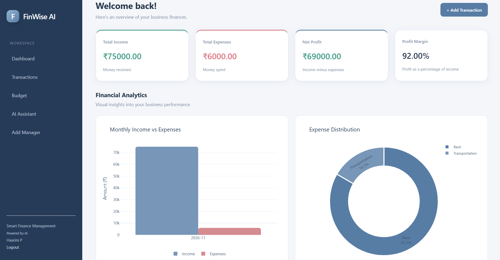
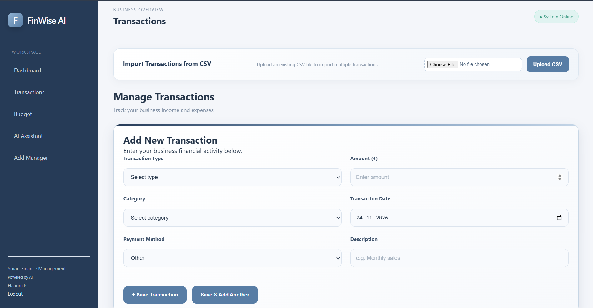
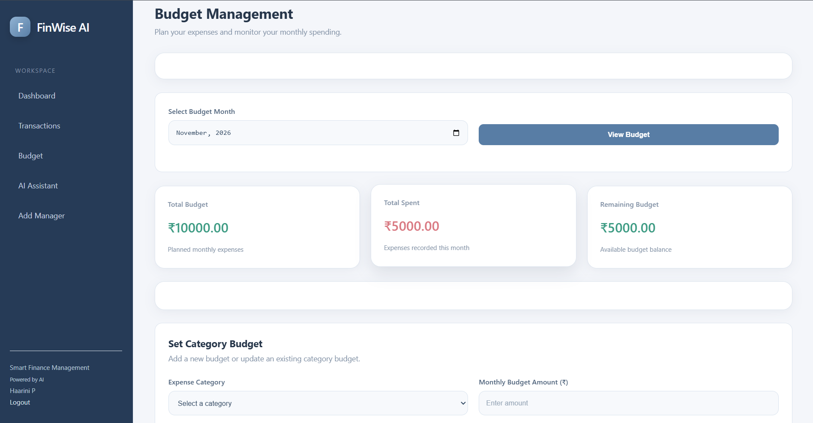
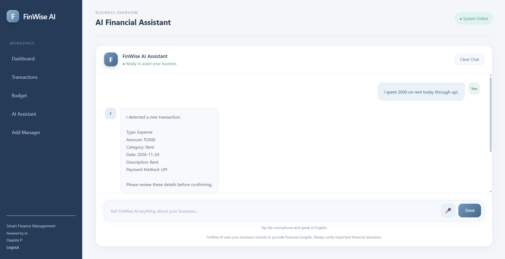
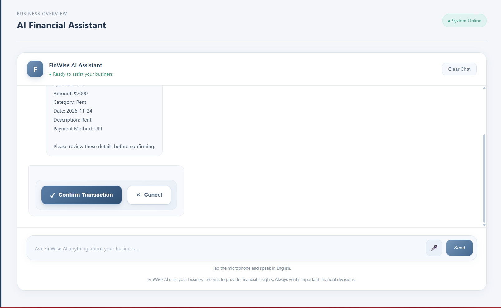
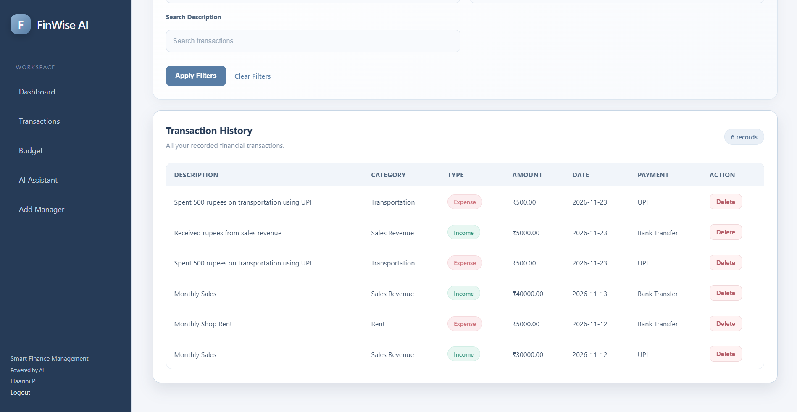

# FinWise AI — AI-Powered Business Finance Assistant

FinWise AI is a web-based financial management application designed to help small businesses manage their income, expenses, budgets, and financial insights in one place.

It combines financial tracking and data visualisation with an AI-powered assistant to make business financial management easier and more accessible.

## Features

- **User Authentication:** Secure login and registration with owner and manager roles.
- **Business Management:** Owner-controlled manager account creation.
- **Transaction Management:** Add, edit, delete, and view income and expense transactions.
- **Dashboard:** Visualise financial performance through interactive charts and summary cards.
- **Budget Management:** Set monthly budgets and monitor category-wise spending.
- **AI Financial Assistant:** Ask questions about business financial data.
- **AI Transaction Detection:** Identify transaction details from natural-language messages and request confirmation before saving.
- **Voice Interaction:** English voice input and spoken AI responses.
- **CSV Import:** Upload transaction data and preview it before importing.

## Application Screenshots

### Dashboard


### Transaction Management


### Budget Management


### AI Financial Assistant


### AI Transaction Confirmation


### Transaction History


## Technologies Used

- Python
- Flask
- SQLite
- HTML
- CSS
- JavaScript
- Plotly
- Google Gemini API
- Speech Recognition and Speech Synthesis Web APIs

## Project Structure

```text
FINWISE_AI/
│
├── app.py
├── config.py
├── database.py
├── requirements.txt
│
├── database/
│
├── modules/
│   ├── auth/
│   ├── financial_tools.py
│   ├── gemini_service.py
│   └── transactions.py
│
├── static/
│   └── css/
│
├── templates/
│
├── .gitignore
└── README.md
```

## Installation and Setup

### 1. Clone the repository

```bash
git clone YOUR_GITHUB_REPOSITORY_URL
cd FINWISE_AI
```

### 2. Create a virtual environment

```bash
python -m venv .venv
```

Activate it:

**Windows PowerShell**
```powershell
.venv\Scripts\Activate.ps1
```

### 3. Install dependencies

```bash
python -m pip install -r requirements.txt
```

### 4. Configure environment variables

Create a `.env` file in the project root:

```env
SECRET_KEY=your_secret_key
GEMINI_API_KEY=your_gemini_api_key
FLASK_DEBUG=false
```

Replace the example values with your own secrets. Never upload `.env` to GitHub.

### 5. Initialise the database

```bash
python -c "from database import init_db; init_db()"
```

### 6. Run the application

```bash
python app.py
```

Open the local application in your browser at:

```text
http://127.0.0.1:5000
```

## Security

- API keys and secret configuration are stored in environment variables.
- Database files and virtual environments are excluded from version control.
- Financial records are scoped to the authenticated user's business.
- AI-detected transactions require user confirmation before saving.

## Future Improvements

- More robust handling of temporary AI service failures.
- Expanded financial analytics and reporting.
- Additional testing of CSV import workflows.
- Further improvements to data security and deployment readiness.

## Project Status

FinWise AI is a portfolio project developed as part of practical learning in Python, data science, web development, and AI integration.

CSV import and the complete transaction clarification workflow still require further end-to-end testing.
